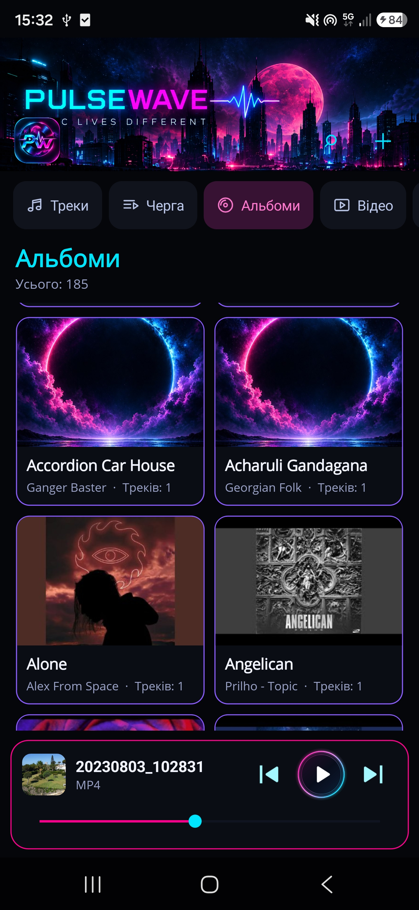
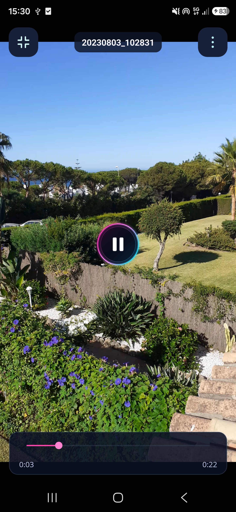

<strong>📸 VIEW SCREENSHOTS (5) — CLICK TO OPEN</strong>

<h3>🎵 PulseWave — Android Screenshots</h3>

<strong>▶️ Music Player</strong>

<strong>⚙️ Track Options</strong>

<strong>💿 Albums Library</strong>

<strong>🎬 Video Player</strong>

# 🎵 PulseWave

**Your music. Your rhythm. Your experience.**

PulseWave is an Android music and media player designed for browsing, organizing and enjoying your local media library.

Featuring a modern dark interface with vibrant neon accents, responsive playback controls and audio visualization, PulseWave brings music and media together in one application.

---

## 🚀 Core Features

### 🎶 Music Library

- Browse audio tracks stored on your Android device.
- Navigate between tracks, queue, albums and video sections.
- Search your media library.
- View track information, audio format and duration.
- Access playback controls through the integrated mini-player.

### ▶️ Music Player

- Full-screen music playback interface.
- Play, pause, skip and seek through tracks.
- Shuffle and repeat playback.
- Interactive playback progress bar.
- Audio visualization with vibrant neon styling.
- Display album artwork and track information.
- Mark favorite tracks.

### 📋 Queue & Track Management

- Access the playback queue.
- View track details and album information.
- Open available audio-track options.
- Share tracks through Android.
- Access track management actions from the context menu.

### 🎨 Interface

- Modern dark theme.
- Cyan, purple and pink neon accents.
- Dedicated full-screen player.
- Compact mini-player for library navigation.
- Touch-friendly playback controls.

---

## 📱 Android

PulseWave is designed for Android smartphones.

The application provides a mobile-first interface for managing and playing locally available media.

---

## 📦 Download

PulseWave releases will be available through the GitHub Releases section.

[**View Releases**](../../releases)

Install the APK on a compatible Android device.

---

## 🛠 Technology

- Android
- Local media playback
- Audio visualization
- Media library management

---

## ⭐ Support the Project

If you enjoy PulseWave, consider giving the repository a ⭐ on GitHub.

---

© 2026 PulseWave
