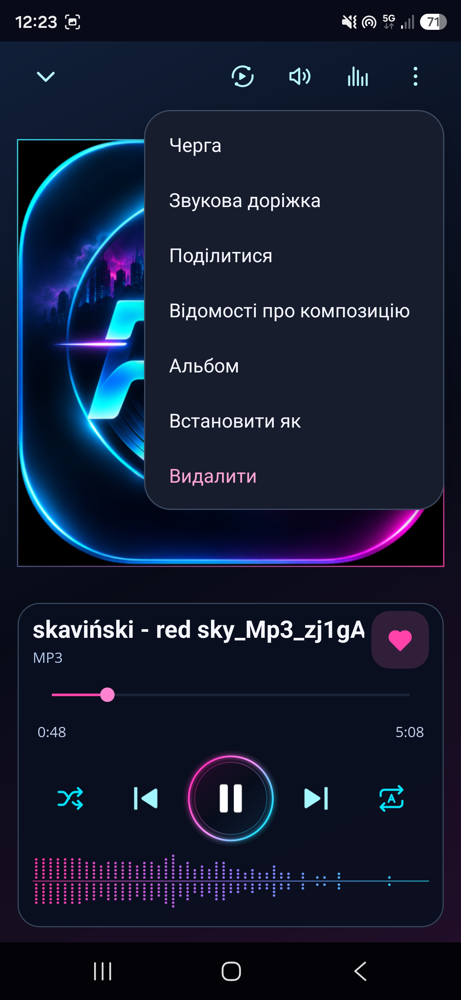
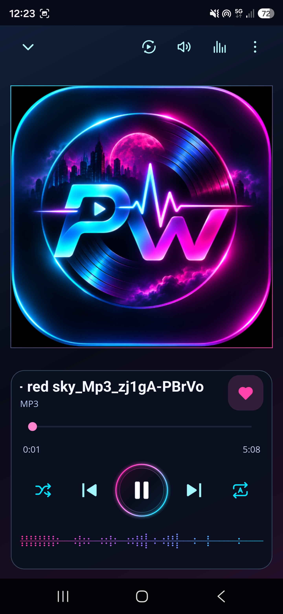
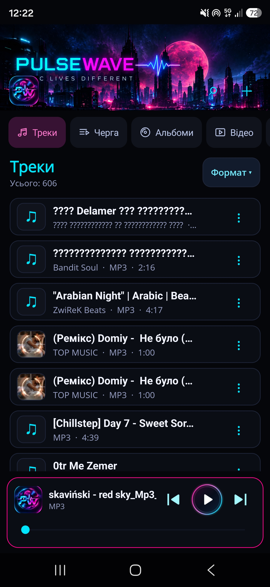

<strong>📸 VIEW SCREENSHOTS (3) — CLICK TO OPEN</strong>

<h3>🎵 PulseWave — Android Screenshots</h3>

<strong>🎶 Music Library</strong>

<strong>▶️ Music Player</strong>

<strong>⚙️ Track Options</strong>

# PulseWave
PulseWave — Android music and media player with audio visualization, playlists and video library.
